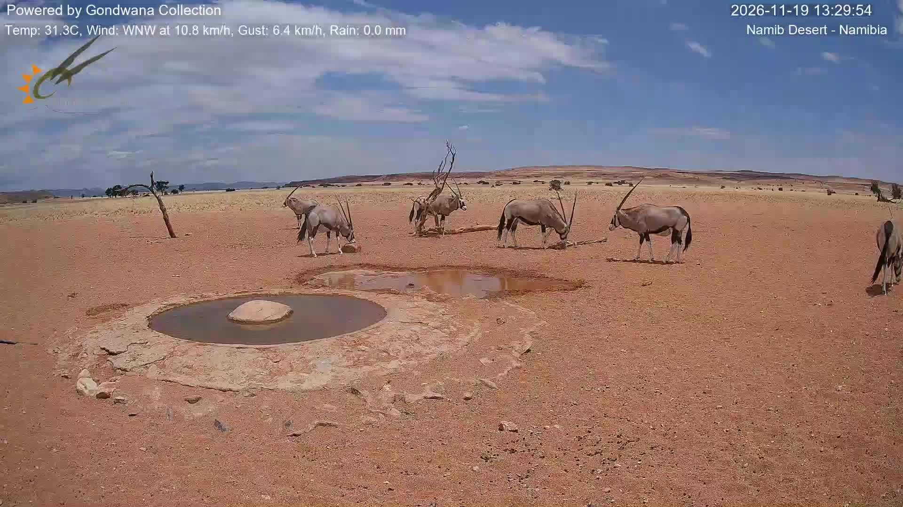
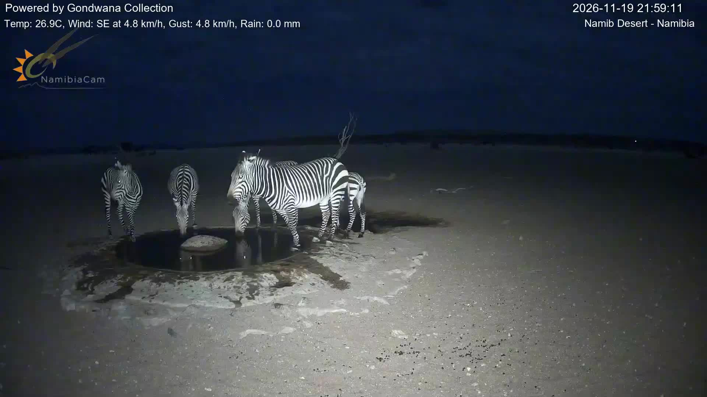

# animalcam

A little window into the wild. Watch YouTube wildlife cams, spot animals **and birds** with GPT-6 Luna, and collect the frames in your own image journal.

| Gemsbok by day | Zebras after dark |
| --- | --- |
|  |  |

Real captures from [NamibiaCam](https://www.youtube.com/watch?v=ydYDqZQpim8).

## Run

```bash
cp -n .env.example .env       # add OPENAI_API_KEY
mkdir -p data
cp -n cams.toml data/cams.toml
ANIMALCAM_UID=$(id -u) ANIMALCAM_GID=$(id -g) docker compose up -d --build
```

Open **http://localhost:8080**. Everything runs in one container. Images, observations, and API usage stay in **`./data`**, mounted at `/data`.

Behind a host HTTPS proxy, set `ANIMALCAM_FORWARDED_ALLOW_IPS=127.0.0.1,<Docker gateway IP>` in `.env` so **Check now** recognizes the original HTTPS origin. Find the gateway with `docker inspect $(docker compose ps -q animalcam) --format '{{range .NetworkSettings.Networks}}{{.Gateway}}{{end}}'`.

Or run the image directly:

```bash
docker build -t animalcam .
docker run -d --name animalcam --init --restart unless-stopped \
  --user "$(id -u):$(id -g)" --env-file .env \
  -p 127.0.0.1:8080:8080 -v "$PWD/data:/data" animalcam
```

## In the journal

- Automatic checks every 15 minutes; **Check now** for a fresh capture.
- Compact gallery, with **Animals or birds** selected by default. Filter by camera, species, date, birds, or new sightings.
- **Random cool sighting** favors animal groups, multiple species, predators, and high-scoring moments. Shuffle picks another frame when available.
- Vega charts rank the top five species (plus others) and show an hourly sighting heatmap, across the full history, grouped by day, Monday-start week, or month in camera-local time. The scrollable heatmap includes hourly totals above and bucket totals on the right. Counts represent frames, not unique animals.
- Click a frame for the full image, counts, confidence, behaviors, events, model JSON, and call cost.
- **Kiwi’s field notes:** your explorer pug shares sourced wildlife facts, cached in SQLite. A new confidently identified species triggers one background Luna web-search lookup against trusted wildlife sources. Facts, source links, and verification dates are reused; unknown identifications are skipped.

**Cool photo ≠ new event.** Luna's `interesting_score` measures novelty against the previous observation. Repeated zebras can score low but still make a great archive highlight. Highlight labels explain animal abundance and variety; novelty scores remain in the details and alert logic.

## Add a camera

Append to `data/cams.toml`; it reloads automatically:

```toml
[[cam]]
id = "another-waterhole"
name = "Another waterhole"
url = "https://www.youtube.com/watch?v=VIDEO_ID"
timezone = "Africa/Windhoek"
```

Each camera has its own history and cooldown. Each Luna call gets one resized JPEG, the camera name/timezone, the previous successful JSON from SQLite, and the observation instructions/schema.

## A few knobs

Set these in `.env`, then recreate the container:

| Setting | Default |
| --- | --- |
| `ANIMALCAM_MODEL` | `gpt-6-luna` |
| `ANIMALCAM_IMAGE_WIDTH` | `960` px wide; full-resolution originals are kept |
| `ANIMALCAM_INTERVAL_MIN` | `15` (minimum 10) |
| `ANIMALCAM_SCHEDULE_ENABLED` | `1`; use `0` for manual checks only |
| `ANIMALCAM_RETENTION_DAYS` | `0` keeps every image; otherwise empty, unalerted images expire |
| `DASHBOARD_PASSWORD` | optional; user defaults to `animalcam` |
| `ALERT_BACKEND` | `none`; choose `ntfy` + `NTFY_TOPIC`, or `discord` + `WEBHOOK_URL` |

Alerts need a new/noteworthy sighting scoring at least 6, confident wildlife, and a 60-minute per-camera cooldown. A changed species set bypasses cooldown. See [`.env.example`](.env.example) and [`SPEC.md`](SPEC.md) for more settings and the observation schema.

## Costs & storage

`data/animalcam.db` has three tables: `checks` (observations), `llm_calls` (usage and costs), and `species_facts` (cached sourced facts). Input, cached reads/writes, output, and web searches are priced separately; reasoning tokens are included in output. The sidebar shows the running estimated total. Failures with missing usage remain unpriced.

Standard Luna estimates use [OpenAI's published rates](https://developers.openai.com/api/docs/models/gpt-6-luna). They are estimates, not invoices. Override rates for another model with `ANIMALCAM_INPUT_USD_PER_MILLION`, `ANIMALCAM_CACHED_INPUT_USD_PER_MILLION`, `ANIMALCAM_CACHE_WRITE_USD_PER_MILLION`, and `ANIMALCAM_OUTPUT_USD_PER_MILLION`. Nonstandard service tiers stay unpriced. Fact lookups count toward the total; failed lookups retry after 24 hours, up to three attempts.

To estimate older successful checks, this makes two calibration calls at the old 1280px size and marks historical rows `source=backfill`. Repeating it skips already tracked checks:

```bash
docker compose exec animalcam python -m animalcam backfill-costs --samples 2
```

Back up `./data` with the container stopped, or use SQLite's backup API for a live database.

## Useful commands

```bash
docker compose logs -f
# One real capture + analysis; no persistent writes or alerts:
docker compose run --rm animalcam run-once --cam namib-waterhole --dry-run
# Refresh yt-dlp and rebuild:
docker compose build --pull --no-cache && docker compose up -d
# Local development (Python 3.12+, uv, ffmpeg, Deno):
uv sync && uv run python -m animalcam serve --host 127.0.0.1
uv run pytest
```

The dashboard binds to localhost. For a remote box, use `ssh -L 8080:127.0.0.1:8080 your-host`, or an HTTPS proxy with a dashboard password. YouTube can reject some cloud IPs; optional `YTDLP_COOKIES=/data/cookies.txt` is supported. Keep yt-dlp current and use cams at a personal, low frequency.
